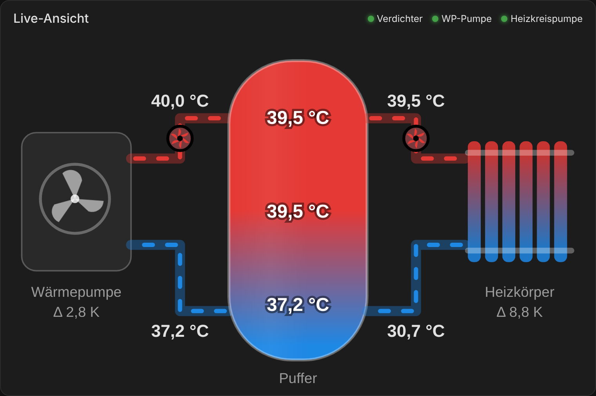
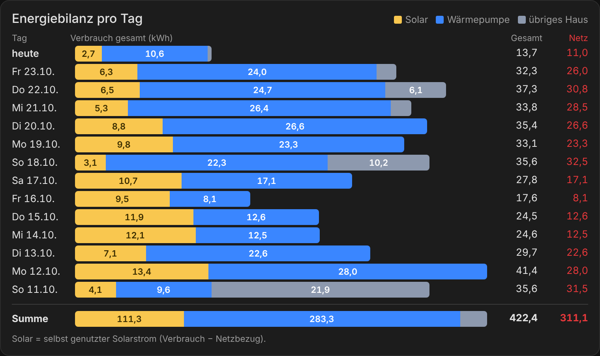

# Blaupunkt-Wärmepumpe (Modbus PW58322) in Home Assistant

Vollständige lokale Einbindung einer Luft/Wasser-Wärmepumpe mit Steuerung nach Modbus-Protokoll **PW58322** in Home Assistant – ohne Cloud, über ein RS485-zu-Ethernet-Gateway.

Getestet mit einer **Blaupunkt BLP13P3V1MR32** (13 kW, Monoblock) und Home Assistant 2026.10. Das Protokoll PW58322 wird auch von baugleichen Geräten anderer Marken genutzt, die dieselbe Steuerung verbauen. Bevor du schreibst, vergleiche die Registerliste mit deiner Anleitung.

*English summary: Home Assistant package for heat pumps using the PW58322 Modbus protocol (e.g. Blaupunkt BLP13P3V1MR32) via a Waveshare RS485-to-Ethernet gateway: all sensors, writable parameters, heating-curve and night-setback automations, efficiency statistics, a 14-day consumption forecast and a ready-made dashboard. Documentation is in German.*

## Ansicht





## Was du bekommst

- **Alle Messwerte**: Vor-/Rücklauf, Außen, Heißgas, Sauggas, Verdampfer, Verdichterfrequenz und -strom, Lüfter, Expansionsventile, DC-Pumpe, Status- und Fehlerbits
- **Bedienung**: Ein/Aus, Betriebsmodus, ECO/Smart/Powerful, Urlaubsmodus, Sollwerte, Heizkurve (P22–P24), Abtauung (P09–P16), Legionellen (P17–P21), Heizstab (P26/P27) und die DC-Umwälzpumpe (F4, F6, F10)
- **Automationen**
  - Zeitplan
  - Heizkurve in 5 Stufen
  - Nachtabsenkung über die Heizkurve statt Abschalten
  - ECO/Smart automatisch nach Außentemperatur
  - Heizkurve automatisch nach Raumtemperatur nachführen
  - kWh je Heizgradtag
- **Auswertung**: Laufzeit, Starts, Abtauungen, mittlere Laufzeit, Leitungsverluste außen ↔ Puffer, Heizstab-Energie, Puffer-Stillstandsverlust
- **Prognose**: Stromverbrauch der nächsten 7 und 14 Tage aus der Open-Meteo-Vorhersage, kalibriert an der eigenen Effizienz
- **Optional**: Pufferfühler über ein Wellpro-Modul, Energiebilanz Haus/PV/Netz/WP pro Tag und Monat
- **Dashboard** mit animierter Pufferkarte und Statistik-Unterseiten
- **Blueprints**: Thermostat nach Raumsensor regeln, Heizkreispumpe folgt Wärmepumpe

## Hardware

| Teil | Zweck |
| --- | --- |
| Waveshare RS485 to ETH (oder ähnliches Gateway) | an den Modbus-Anschluss (A/B) der WP-Steuerung, Modus „Modbus TCP to RTU“ |
| Stromzähler für die WP (z. B. 3-phasiger WLAN-Zähler) | Leistung je Phase und Gesamtenergie |
| optional: Wellpro WP3082ADAM + 4× DS18B20 + zweites Gateway | Fühler an Puffer-Ein- und -Ausgängen |
| optional: Messsteckdose für die Heizkreispumpe | Pumpe folgt der WP, Laufanzeige |

Gateway-Einstellungen: 9600 Baud, 8N1, TCP-Server Port 502, Protokoll „Modbus TCP to RTU“. Slave-Adresse der WP laut DIP-Schalter (alle aus = 1).

## Installation

1. **Pakete aktivieren**: In `configuration.yaml` ergänzen (falls noch nicht vorhanden):

   ```yaml
   homeassistant:
     packages: !include_dir_named packages
   ```

2. **Dateien kopieren** in deinen Konfigurationsordner:
   - `packages/*.yaml` → `packages/`. Die Energiebilanz ist optional; wenn du sie nicht willst, lass `energiebilanz.yaml` weg.
   - `custom_templates/wp_prognose.jinja` → `custom_templates/`
   - `www/*.js` → `www/`
   - `blueprints/automation/waermepumpe/` → `blueprints/automation/waermepumpe/`
3. **secrets.yaml** ergänzen:

   ```yaml
   wp_modbus_host: 192.168.1.50      # Gateway an der Wärmepumpe
   puffer_modbus_host: 192.168.1.51  # Gateway am Puffer (oder Hub in waermepumpe_modbus.yaml löschen)
   ```

4. **ANPASSEN-Stellen** bearbeiten (in den Dateien nach `ANPASSEN` suchen):
   - Entitäten deines WP-Stromzählers (`sensor.wp_energiemeter_*`)
   - Heizkreispumpe
   - Raumsensoren für die Heizkurven-Automatik
   - Heizstab-Leistung und Puffer-Verlust
   - Modellwerte in `wp_prognose.jinja`
5. **Home Assistant neu starten**. Ein YAML-Reload reicht für Modbus nicht.
6. Einmal das Skript **„Wärmepumpe Standardwerte setzen“** ausführen.
7. **Ressourcen** anlegen (Einstellungen › Dashboards › ⋮ › Ressourcen, Typ JavaScript-Modul):
   - `/local/puffer-speicher-card.js`
   - `/local/energiebilanz-card.js`
8. Aus **HACS** die Karte `ring-tile` installieren. Das Dashboard nutzt sie.
9. **Dashboard** anlegen: neues Dashboard › ⋮ › Raw-Konfigurationseditor › Inhalt von `dashboards/waermepumpe.yaml` einfügen.
10. Für jedes Heizkörperthermostat eine Automation aus dem Blueprint anlegen (optional).

## ⚠️ Wichtig vor dem ersten Schreiben

- **Jeder Schreibzugriff landet im Flash der Wärmepumpe.** Die Automationen schreiben nur bei echter Änderung. Baue keine Automation, die zyklisch Register schreibt.
- **P08 (Wassertemperatur-Kompensation, 0x0092)** stand ab Werk auf 7 K. Damit melden die WP-eigenen Fühler mehrere Kelvin zu viel, und die WP schaltet zu früh ab. Mit Anlegefühlern am Rohr vergleichen; beim Autor war 0 richtig.
- **Skalierung**: Rücklauf 0,1 °C pro Bit, alle anderen Temperaturen 0,5 °C. Das ist korrekt so, obwohl es seltsam aussieht.
- **DC-Pumpe**: Im Modus Automatik regelt die Pumpe auf die Soll-Spreizung F10 und läuft meist auf der Mindestdrehzahl F8. Manuell mit hoher Drehzahl kostet nur Strom.

## Dokumentation

- [docs/modbus-register.md](docs/modbus-register.md) – alle Register mit Adresse, Skalierung und Bits
- [docs/funktionsweise.md](docs/funktionsweise.md) – was die Automationen tun und wie die Prognose rechnet
- [docs/erfahrungen.md](docs/erfahrungen.md) – Erkenntnisse aus dem ersten Betrieb

Die Modbus-Protokolle (PDF) des Herstellers sind nicht enthalten. Du bekommst sie beim Händler oder Hersteller deiner Wärmepumpe.

## Haftung

Nutzung auf eigene Gefahr. Falsche Parameter können die Wärmepumpe beschädigen oder die Garantie gefährden. Prüfe jeden Wert gegen die Anleitung deines Geräts.

## Lizenz

MIT, siehe [LICENSE](LICENSE).
