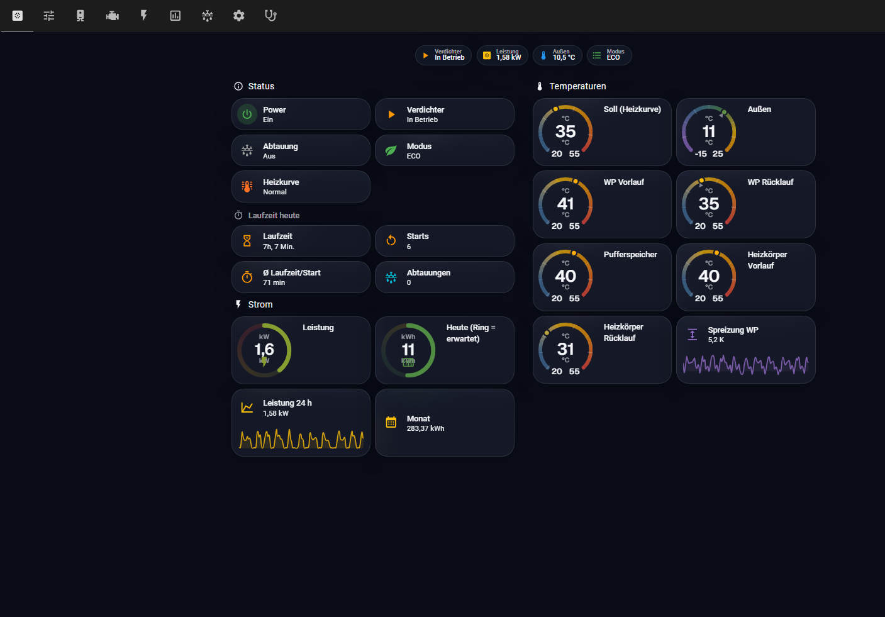
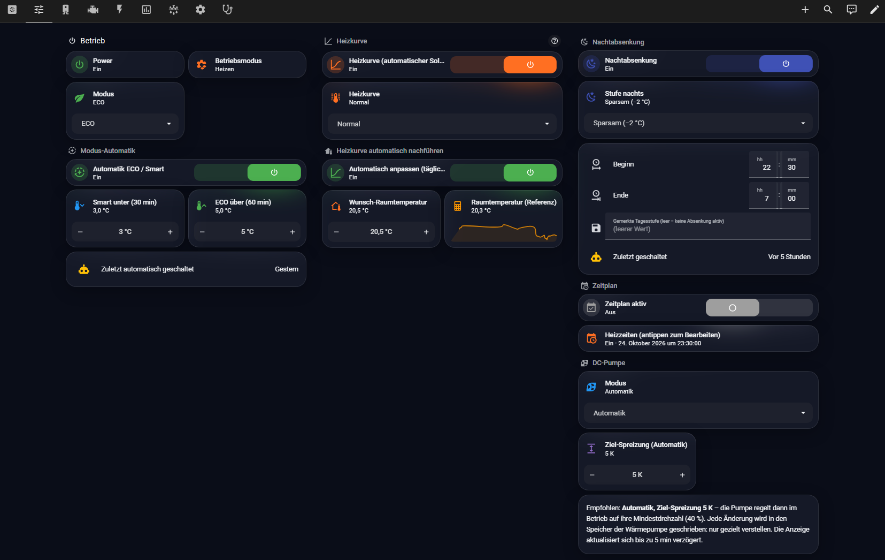
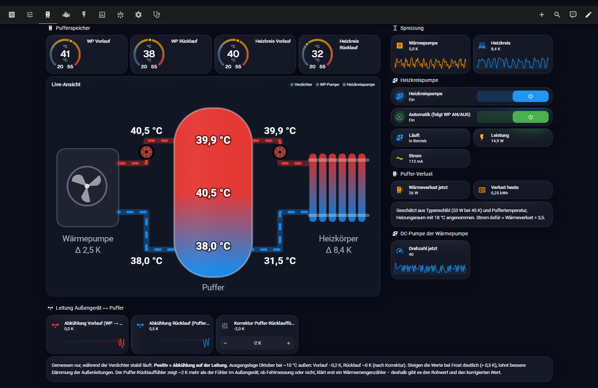
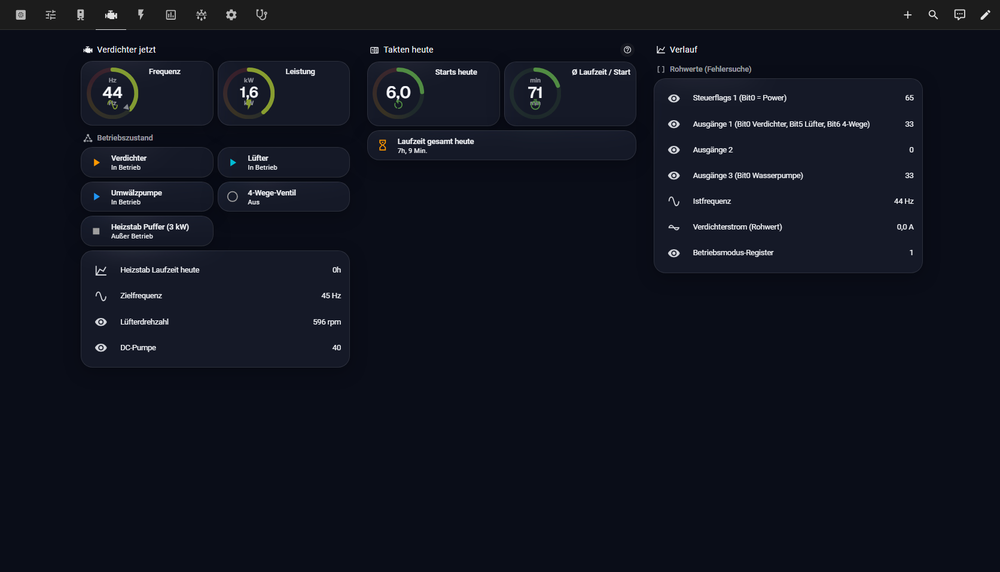
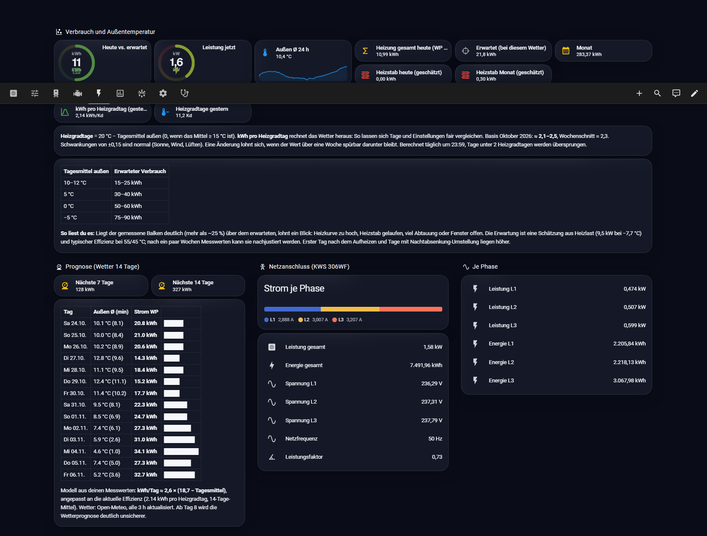
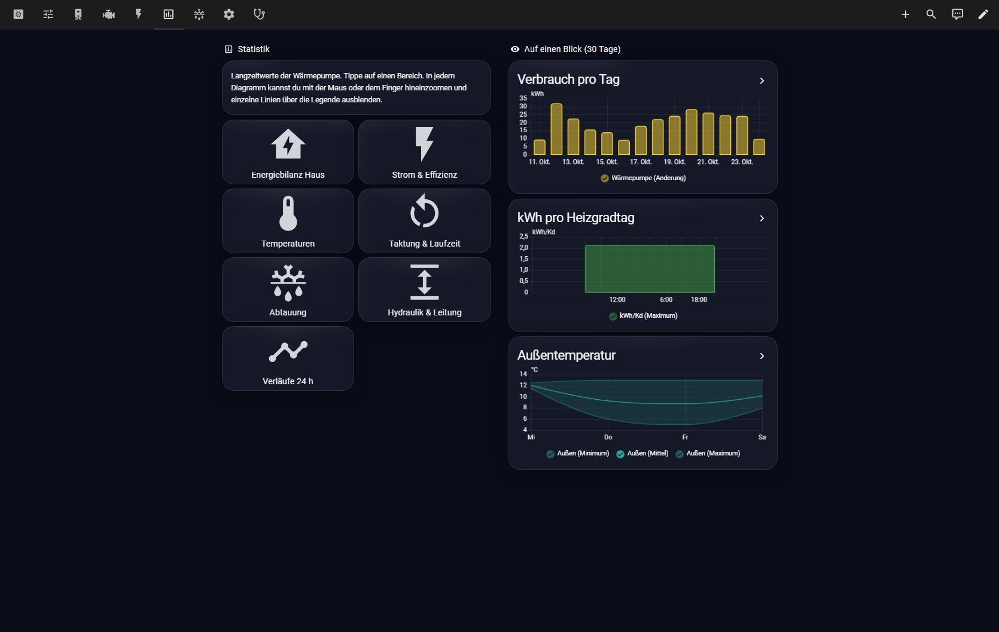
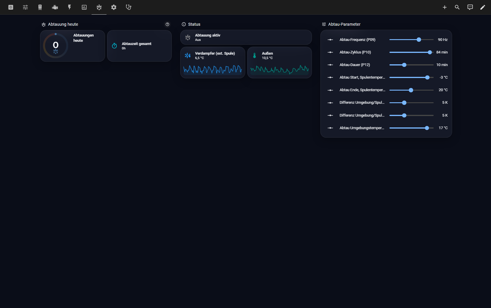
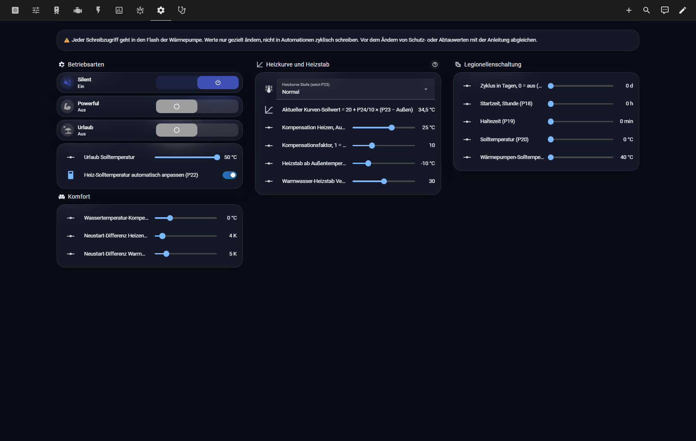
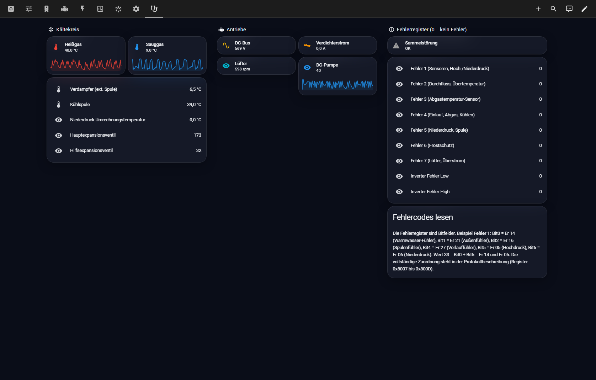

# Dashboard

Das Dashboard `dashboards/waermepumpe.yaml` hat neun Tabs. So sehen sie im Betrieb aus (dunkles Design).

## Übersicht

Status, Laufzeit heute, Strom und alle Temperaturen auf einen Blick.

## Steuerung

Betrieb, ECO/Smart-Automatik, Heizkurve mit automatischer Nachführung, Nachtabsenkung, Zeitplan und DC-Pumpe.

## Puffer

Pufferkarte mit Live-Temperaturen, Spreizungen, Heizkreispumpe, Puffer-Verlust und Leitungsverluste außen ↔ Puffer.

## Verdichter

Frequenz, Leistung, Betriebszustand, Takten heute und Rohwerte zur Fehlersuche.

## Energie

Verbrauch gegen Erwartung, kWh je Heizgradtag, 14-Tage-Prognose und Stromzähler je Phase.

## Statistik

Einstieg in die Unterseiten mit Langzeitgrafiken und Kurzübersicht der letzten 30 Tage.

## Abtauung

Abtauungen heute, Verdampfer- und Außentemperatur, Abtau-Parameter P09–P16.

## Einstellungen

Silent, Powerful, Urlaub, P22, Komfortwerte, Heizkurve, Heizstab und Legionellenschaltung.

## Diagnose

Kältekreis, Antriebe und alle Fehlerregister mit Lesehilfe.

