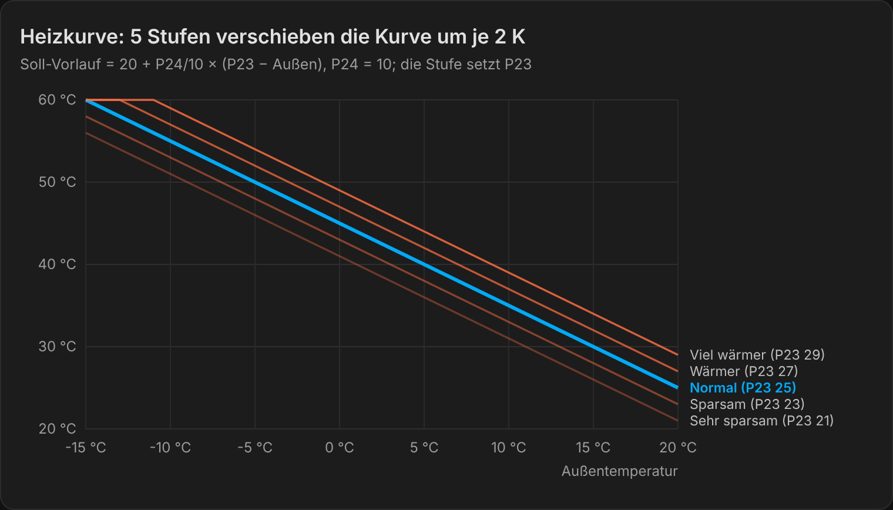
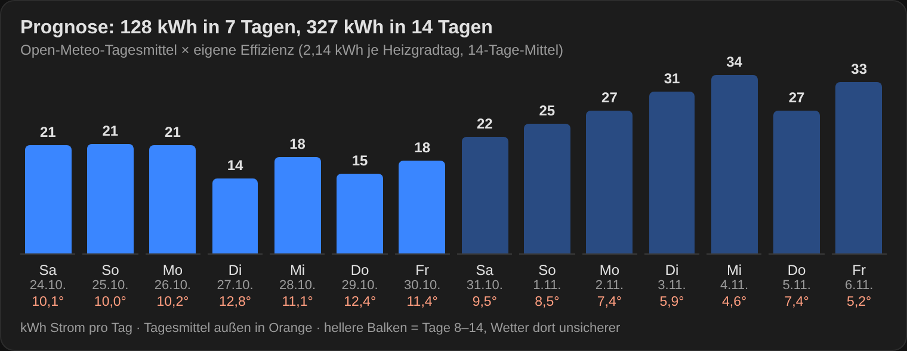

# Funktionsweise

Die Wärmepumpe regelt den Vorlauf selbst nach ihrer Heizkurve (P22 an). Home Assistant verschiebt nur diese Kurve, schaltet Zeiten und Modi und wertet aus. Geschrieben wird nur bei echter Änderung, damit der Flash der WP geschont wird.

## Automationen

| Automation | Was sie tut | Ein/Aus |
| --- | --- | --- |
| WP Zeitplan | schaltet die WP nach `schedule.wp_heizzeiten`. Geschaltet wird nur am Anfang und am Ende eines Fensters, Handbedienung dazwischen bleibt erhalten. | `input_boolean.wp_zeitplan_aktiv` |
| WP Heizkurve Stufe übernehmen | setzt P23 nach der gewählten Stufe: Sehr sparsam 21, Sparsam 23, Normal 25, Wärmer 27, Viel wärmer 29 | – |
| WP Nachtabsenkung | merkt sich zu Beginn die Tagesstufe, stellt die Nachtstufe ein und setzt sie zum Ende zurück. Eine nachts von Hand gewählte Stufe bleibt stehen. | `input_boolean.wp_nachtabsenkung` |
| WP Modus automatisch | Smart nach 30 min unter `wp_smart_unter`, ECO nach 60 min über `wp_eco_ueber`. Nutzt die gefilterte Außentemperatur; Powerful wird nie überschrieben. | `input_boolean.wp_modus_automatik` |
| WP Heizkurve automatisch anpassen | prüft täglich um 21:00 das Tagesmittel der Raumtemperatur (`sensor.raumtemperatur_referenz`). Bei mehr als 0,7 K zu warm eine Stufe sparsamer, bei mehr als 0,5 K zu kalt eine Stufe wärmer, höchstens eine Stufe pro Tag. | `input_boolean.heizkurve_automatisch_anpassen` |
| WP kWh pro Heizgradtag berechnen | 23:59: Heizgradtage (20 °C − Tagesmittel, nur unter 15 °C) und kWh je Heizgradtag | – |

Die beiden Blueprints ergänzen das:
- **Thermostat nach Raumsensor**: Die Thermostate regeln auf die echte Raumtemperatur statt auf ihren Fühler am Heizkörper.
- **Heizkreispumpe folgt Wärmepumpe**: Die Pumpe hinter einem Trennpuffer läuft nur, solange die WP an ist.



## Warum Nachtabsenkung statt Abschalten

Eine abgeschaltete WP muss morgens das ganze Haus mit hoher Leistung und schlechtem COP wieder aufheizen. Eine um eine Stufe abgesenkte Heizkurve (−2 K Vorlauf) spart weniger auf dem Papier, vermeidet aber diese Spitze. Ob es sich lohnt, zeigt der Vergleich der kWh je Heizgradtag vor und nach der Umstellung.

## Gefilterte Außentemperatur

Der Außenfühler der WP springt beim Abtauen und in Verdichterpausen um bis zu 3 K. `sensor.wp_aussentemperatur_gefiltert` hält den letzten Wert während der Abtauung und bis 20 Minuten danach. Die ECO/Smart-Umschaltung wartet zusätzlich 30 bzw. 60 Minuten.

## kWh je Heizgradtag

Ein Heizgradtag ist 1 K Unterschied zwischen 20 °C und dem Tagesmittel außen. Strom geteilt durch Heizgradtage macht Tage mit unterschiedlichem Wetter vergleichbar. Steigt der Wert, ist etwas schlechter geworden; sinkt er, hat eine Optimierung gewirkt. Unter 2 Heizgradtagen wird nichts berechnet, weil der Wert dann zu ungenau ist.

## Prognose

Die Prognose rechnet `kWh/Tag = STEIGUNG × (HEIZGRENZE − Tagesmittel)` für jeden der 14 Vorhersagetage von Open-Meteo. Die Steigung wird mit dem 14-Tage-Mittel der kWh je Heizgradtag skaliert, die Prognose folgt also der aktuellen Effizienz. Die drei Modellwerte stehen oben in `custom_templates/wp_prognose.jinja` und müssen an das eigene Haus angepasst werden.



Im Dashboard zeigt die Karte `custom:prognose-card` diese Ansicht. Wer die Modellwerte in `wp_prognose.jinja` ändert, trägt sie auch in der Karte ein:

```yaml
type: custom:prognose-card
steigung: 2.6
heizgrenze: 18.7
basis: 2.3
```

## Leitungsverluste

Mit Pufferfühlern lassen sich die WP-eigenen Fühler (außen am Gerät) mit den Fühlern am Puffer (innen) vergleichen. `sensor.wp_leitung_verlust_vorlauf` und `_rucklauf` zeigen die Differenz nur bei stabil laufendem Verdichter. Aussagekräftig wird das erst bei Frost. Mehr als 1 K Unterschied auf einer kurzen Leitung deutet auf schlechte Dämmung hin.

Hat ein Fühler einen festen Versatz, gleicht `input_number.korrektur_puffer_wp_rucklauf` ihn aus. Den Versatz bestimmst du durch Vergleich bei Stillstand oder mit einem Referenzthermometer.

## Energiebilanz (optional)

Zwei Template-Sensoren legen kurz vor Mitternacht die Tageswerte und am Monatsende die Monatswerte als Liste ab: Haus, PV, Netzbezug, Einspeisung und Wärmepumpe. Die Karte `custom:energiebilanz-card` zeigt sie als geteilten Balken: Solar gelb, WP blau, übriges Haus grau. Rechts stehen Gesamt und Netzbezug.

```yaml
type: custom:energiebilanz-card
mode: tage        # oder: monate
hinweis: "WP-Zähler ab 01.10."   # optional
```
